# Manual do Robô Xiaozhi

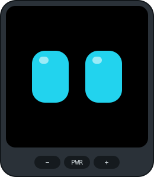

Tudo o que o robô sabe fazer, com o que aparece na tela e o que falar para ele.
Ele entende português: fale normalmente, as frases abaixo são só exemplos.

Placa: **Waveshare ESP32-S3-LCD-1.54** · tela 240×240 · 3 botões (`−`, `PWR`, `+`).

**Versão para imprimir:** [Manual-Robo-Xiaozhi.pdf](Manual-Robo-Xiaozhi.pdf)

<br clear="right">

## Índice

1. [Primeiros passos](#primeiros-passos)
2. [Os 3 botões](#os-3-botões)
3. [Rosto e emoções](#rosto-e-emoções)
4. [Timer, alarme e lembrete](#timer-alarme-e-lembrete)
5. [Memória pessoal](#memória-pessoal)
6. [Música, rádio e podcast](#música-rádio-e-podcast)
7. [Vídeos do cartão SD](#vídeos-do-cartão-sd)
8. [Jogos](#jogos)
9. [Internet, notícias e fotos](#internet-notícias-e-fotos)
10. [Clima e cotações](#clima-e-cotações)
11. [Tradutor](#tradutor)
12. [Casa inteligente (Home Assistant)](#casa-inteligente-home-assistant)
13. [Página de configurações](#página-de-configurações)
14. [Robô e PC](#robô-e-pc)
15. [Especificações](#especificações)
16. [Problemas comuns](#problemas-comuns)

---

## Primeiros passos

Ligue o robô num carregador USB ou no PC. Ele precisa de WiFi com internet para conversar.

### Conectar ao WiFi

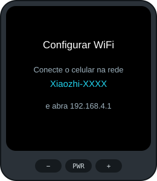

1. Na primeira vez, o robô cria uma rede WiFi chamada `Xiaozhi-…`.
2. Conecte o celular nessa rede. A página de configuração abre sozinha. Se não abrir, acesse `192.168.4.1`.
3. Escolha a rede da sua casa, digite a senha e salve. O robô reinicia e conecta.

Para trocar de rede depois, peça ao robô. Ele pede confirmação antes de mudar:

- *"Entra no modo de configuração de WiFi"*

<br clear="right">

### Ativar o robô na sua conta (obrigatório)

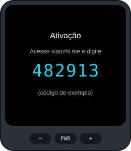

Depois de conectar ao WiFi pela primeira vez, o robô mostra e fala um **código de 6 dígitos**. Sem ativar, ele não conversa.

1. No celular ou no computador, entre em **xiaozhi.me** e crie uma conta grátis, ou entre na sua.
2. No painel (Console), toque em **Adicionar dispositivo** (*Add device*).
3. Digite o código que está na tela do robô e confirme.
4. Pronto: o robô avisa que está ativado. Isso só é feito uma vez.

No mesmo painel, nas configurações do agente, você escolhe a **voz**, o **idioma**, a **personalidade** e o nome do robô.

> [!TIP]
> Se o código sumir antes de você digitar, reinicie o robô tirando e colocando o cabo. Um código novo aparece.

<br clear="right">

### Bateria

O robô funciona com uma bateria de lítio de 3,7 V ligada no conector de bateria da placa, e carrega pelo USB-C.

- **Ligar:** aperte `PWR`.
- **Desligar:** segure `PWR` por alguns segundos.
- **Carregar:** ligue o cabo USB-C num carregador de celular. Ele funciona normalmente enquanto carrega.
- **Ver a carga:** pergunte *"quanto de bateria você tem?"*.

> [!IMPORTANT]
> Na bateria, para economizar, ele se desliga sozinho depois de **5 minutos sem conversa**. Ele **não** desliga enquanto toca música ou vídeo, enquanto há um timer ou alarme marcado, ou durante o labirinto. Com um alarme para o dia seguinte, ele fica ligado a noite toda e gasta bateria: nesse caso, deixe no carregador. No carregador, ele nunca se desliga sozinho.
>
> Os avisos de lembretes da memória e o alerta de chuva só funcionam com ele ligado.

### Conversar

Diga **"Jarvis"** (pronuncia-se "djárvis") ou aperte `PWR` uma vez, e fale. Ele responde e continua ouvindo. Aperte `PWR` de novo para encerrar a conversa.

> [!NOTE]
> A palavra "Jarvis" só funciona com o robô **ligado no cabo** (carregador ou PC). Na bateria ela fica desligada para economizar: use o botão `PWR`.

---

## Os 3 botões

Cada botão muda de função conforme o que está na tela.

| Situação | `−` | `PWR` | `+` |
|---|---|---|---|
| Normal | Diminui o volume | Começa ou encerra a conversa · **segurar**: desliga (na bateria) | Aumenta o volume · **2 cliques**: menu de olhos |
| Menu de olhos | Estilo anterior | Confirma o estilo | Próximo estilo |
| Quiz | Responde A | Responde B | Responde C |
| Alarme tocando | Desliga | Desliga | Desliga |
| Labirinto | — | Sai do jogo | — |
| Página de configurações | — | Fecha a página | — |

---

## Rosto e emoções

O rosto reage sozinho ao que acontece: à conversa, ao movimento, à hora do dia e ao silêncio.

### Cor dos olhos

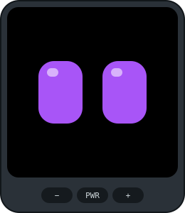

Pode ser qualquer cor: pelo nome, como vermelho, verde, azul, ciano, amarelo, laranja, roxo, rosa, magenta, branco ou dourado, ou por um código como `#FF8800`. A cor fica salva.

- *"Muda a cor dos olhos para roxo"*
- *"Deixa os olhos dourados"*

<br clear="right">

### Estilo dos olhos (12 opções)

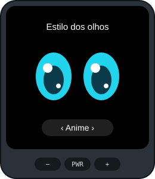

Robô · Oval brilhante · Binóculo · Pontinhos · Quadrado · Pixel · Desenho · Realista · Anime · Chibi · Gato · Vintage

Peça pelo nome ou abra o menu: dê **2 cliques** em `+` ou peça por voz. No menu, `−` e `+` mostram cada estilo ao vivo e `PWR` confirma.

- *"Usa os olhos de gato"*
- *"Abre o menu de olhos"*

<br clear="right">

### Sensor de movimento

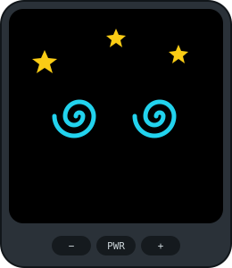

- **Inclinar:** os olhos olham para o lado da inclinação.
- **Balançar ou empurrar:** o rosto balança junto.
- **Sacudir ou girar forte:** ele fica tonto, com espirais nos olhos e estrelas amarelas rodando em volta.
- **Pegar no colo:** se estiver dormindo, ele acorda.

<br clear="right">

### Sono, humor e microexpressões

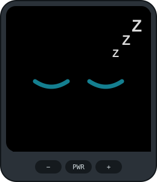

- Depois de um tempo sem conversa nem movimento, ele **dorme**: fecha os olhos, mostra Zzz e a tela fica bem fraca. Acorda com o botão, com voz, com movimento ou com música.
- O **humor muda com a hora**: de manhã cedo e à noite ele fica mais sonolento e dorme mais rápido.
- Parado, ele faz **microexpressões**: pisca, olha em volta e boceja.
- Na conversa, os olhos mostram feliz, rindo, triste, chorando com lágrimas, bravo, surpreso, pensando e **apaixonado**, com olhos de coração.

<br clear="right">

### Girar a tela

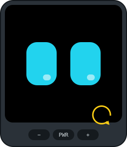

Gira 90°, 180° ou 270°, para usar o robô em pé, deitado ou pendurado. O sensor de movimento gira junto e a posição fica salva.

- *"Vira a tela de cabeça para baixo"*
- *"Gira a tela 90 graus"*
- *"Volta a tela ao normal"*

<br clear="right">

---

## Timer, alarme e lembrete

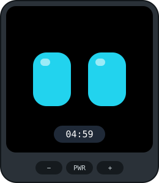

Ele conta o tempo mesmo quando você não está conversando.

- *"Timer de 5 minutos"*
- *"Me acorda às 7 horas"*
- *"Me lembra de tirar o bolo às 15h30"*
- *"Quais alarmes eu tenho?"*
- *"Cancela o alarme das 7"*

O próximo timer aparece numa etiqueta embaixo dos olhos. Na hora, ele toca bipes que **sobem de tom e de volume** por até 60 segundos e fala o que era o lembrete.

**Para desligar:** aperte qualquer botão ou sacuda o robô.

<br clear="right">

---

## Memória pessoal

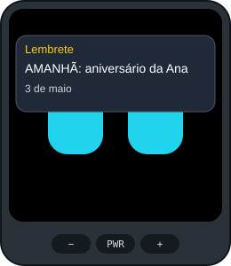

Ele guarda o que você pedir para lembrar, mesmo depois de desligado.

- *"Lembra que a Ana faz aniversário dia 3 de maio"*
- *"Anota que meu time é o Grêmio"*
- *"Quando é o aniversário da Ana?"*
- *"O que você lembra de mim?"*
- *"Esquece o aniversário da Ana"*

Detalhes:

- Lembranças com data avisam **no dia anterior e no próprio dia**, entre 9h e 22h, na tela e por voz.
- Data só com dia e mês repete todo ano.
- Sem cartão SD, cabem umas 50 a 100 frases curtas. Com cartão SD, não há limite prático, e o arquivo `memoria.json` pode ser aberto no PC.

<br clear="right">

---

## Música, rádio e podcast

A música toca quando você não está conversando. Ela pausa quando você fala e volta sozinha depois.

### Músicas do cartão SD

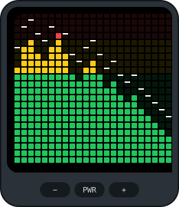

Copie as músicas para qualquer pasta do cartão SD, menos a pasta `videos`. Formatos: `mp3`, `wav`, `flac`, `aac`, `m4a` e `ogg`. O nome do arquivo é o nome da música.

- *"Toca música"* · *"Toca Garota de Ipanema"* · *"Toca em ordem aleatória"*
- *"Pausa"* · *"Continua"* · *"Próxima"* · *"Anterior"* · *"Para a música"*
- *"O que está tocando?"* · *"Quais músicas tem?"*

Enquanto toca, a tela vira um **equalizador de LEDs** com 24 barras verdes, amarelas e vermelhas.

<br clear="right">

### Da internet

| O quê | Exemplo para falar | Detalhe |
|---|---|---|
| Rádio | "Toca a rádio Jovem Pan" · "Toca uma rádio de jazz" | "Próxima" troca de estação |
| Podcast | "Toca o último episódio do Nerdcast" | "Próxima" vai para episódios mais antigos |
| Música livre | "Toca música livre de piano clássico" | Músicas de domínio público do Internet Archive. Não tem músicas de artistas famosos |
| Link direto | "Toca este link: …" | Endereço de um arquivo MP3, AAC ou OGG |

### Que música é essa?


Ele ouve 10 segundos de uma música tocando perto e mostra o nome, o artista e a capa.

- *"Que música é essa?"*
- *"Descobre essa música"*

> [!IMPORTANT]
> Precisa de uma chave grátis do AudD (dashboard.audd.io). Cole a chave na [página de configurações](#página-de-configurações).

<br clear="right">

---

## Vídeos do cartão SD


Os vídeos precisam ser convertidos no PC antes. O robô toca imagem 240×240 a 15 quadros por segundo, com som.

Cada vídeo vira dois arquivos com o mesmo nome: `nome.mjpeg` (imagem) e `nome.mp3` (som). Os dois ficam na pasta `videos`, na raiz do cartão SD.

- *"Quais vídeos tem?"*
- *"Toca o vídeo da turma"*
- *"Pausa"* · *"Para o vídeo"*

Quando você fala com ele, o vídeo pausa e o rosto volta. Ele continua do mesmo ponto depois.

<br clear="right">

### Passo 1 · Instalar o ffmpeg (uma vez só)

O ffmpeg é um programa gratuito que converte vídeos.

**Windows 10 ou 11:** abra o menu Iniciar, digite `cmd`, abra o Prompt de Comando e cole a linha abaixo. Depois feche e abra o Prompt de novo.

```bat
winget install --id Gyan.FFmpeg -e
```

**Mac** (com Homebrew):

```bash
brew install ffmpeg
```

**Linux:**

```bash
sudo apt install ffmpeg
```

### Passo 2 · Converter um vídeo

No Prompt (ou Terminal), entre na pasta do vídeo. No Windows, digite `cd`, um espaço, arraste a pasta para a janela e aperte Enter. Depois rode os dois comandos, trocando `meu video` pelo nome do seu arquivo.

Imagem:

```bash
ffmpeg -i "meu video.mp4" -an -vf "scale=240:240:force_original_aspect_ratio=decrease,pad=240:240:(ow-iw)/2:(oh-ih)/2:black,fps=15" -c:v mjpeg -q:v 6 -pix_fmt yuvj420p -f mjpeg "meu video.mjpeg"
```

Som:

```bash
ffmpeg -i "meu video.mp4" -vn -ac 1 -ar 24000 -c:a libmp3lame -b:a 64k "meu video.mp3"
```

> [!NOTE]
> Se o vídeo não tiver som, o segundo comando dá erro. Nesse caso, crie um som mudo com a duração do vídeo em segundos, aqui 60:
>
> ```bash
> ffmpeg -f lavfi -i anullsrc=r=24000:cl=mono -t 60 -c:a libmp3lame "meu video.mp3"
> ```

### Atalho para o Windows: converter arrastando

Para não digitar comandos toda vez:

1. Abra o Bloco de Notas e cole o texto abaixo.
2. Clique em **Arquivo › Salvar como**, escolha "Todos os arquivos" e salve como `converter.bat`.
3. Arraste um ou mais vídeos em cima desse arquivo. Ele cria a pasta `videos` ao lado dele, pronta para copiar para o cartão.

```bat
@echo off
chcp 65001 >nul
set "SAIDA=%~dp0videos"
if not exist "%SAIDA%" mkdir "%SAIDA%"
for %%F in (%*) do (
  echo Convertendo %%~nxF
  ffmpeg -hide_banner -loglevel error -y -i "%%~fF" -an -vf "scale=240:240:force_original_aspect_ratio=decrease,pad=240:240:(ow-iw)/2:(oh-ih)/2:black,fps=15" -c:v mjpeg -q:v 6 -pix_fmt yuvj420p -f mjpeg "%SAIDA%\%%~nF.mjpeg"
  ffmpeg -hide_banner -loglevel error -y -i "%%~fF" -vn -ac 1 -ar 24000 -c:a libmp3lame -b:a 64k "%SAIDA%\%%~nF.mp3"
)
echo Pronto! Copie a pasta "videos" para o cartao SD.
pause
```

### Passo 3 · Copiar para o cartão

Desligue o robô, tire o cartão SD e coloque no PC. Crie a pasta `videos` na raiz do cartão, se ainda não existir, e copie para ela os arquivos `.mjpeg` e `.mp3`. Devolva o cartão ao robô.

Um minuto de vídeo ocupa uns 10 a 15 MB.

---

## Jogos

Durante os jogos, os olhos e as legendas somem para dar espaço à tela do jogo.

### Dado, moeda e número


O dado gira, quica e vai parando até mostrar o resultado.

- *"Joga um dado"*
- *"Cara ou coroa"*
- *"Sorteia um número de 1 a 100"*

<br clear="right">

### Quiz e Verdadeiro ou falso

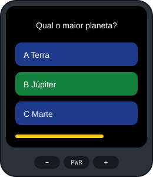

Ele faz perguntas com 3 opções e um tempo para responder. Responda pelos botões (`−` A, `PWR` B, `+` C) ou falando. No fim, mostra os pontos e o recorde.

- *"Vamos jogar quiz de história"*
- *"Quiz de futebol, nível difícil"*
- *"Jogo de verdadeiro ou falso sobre animais"*
- *"Para o quiz"*

<br clear="right">

### Forca

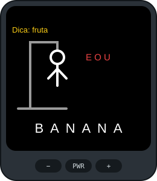

Ele escolhe uma palavra com dica e você fala as letras, ou chuta a palavra inteira. São 6 erros para perder.

**Dica:** fale a letra junto com uma palavra, como *"I de igreja"* ou *"B de bola"*. Letras soltas se confundem fácil no reconhecimento de voz (E e I, B e D, M e N).

- *"Vamos jogar forca"* · *"A de abacaxi"* · *"É banana!"*

<br clear="right">

### Gênio (adivinhação sem limite)

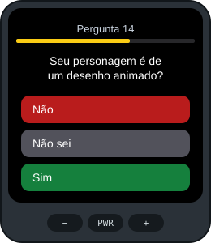

Pense em um **personagem** (real ou de ficção), um **animal** ou um **objeto**. O gênio faz perguntas até descobrir. **Não há limite de perguntas.**

- **Responda falando:** "sim", "não", "não sei", "provavelmente sim" ou "provavelmente não". Ou use os botões: `−` não, `PWR` não sei, `+` sim.
- A **barra de certeza** vai de roxo (com dúvida) a verde (quase certo).
- Quando acha que sabe, ele dá o palpite com uma foto. Responda com `+` (acertou) ou `−` (errou).
- Se errar, o jogo **continua**: ele faz mais perguntas e não repete o palpite errado.
- O robô guarda o jogo inteiro, então o gênio não esquece o que você já respondeu.

Fale: *"Vamos jogar o gênio"* · *"Pensei em um personagem"* · *"Provavelmente não"* · *"Desisto, quem era?"*

<br clear="right">

### Labirinto de inclinação

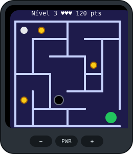

Incline o robô para rolar a bolinha até a saída verde.

- **Moedas** dão pontos e **relógios** dão mais tempo.
- **Buracos** tiram uma das 3 vidas.
- A cada nível, o labirinto cresce e a bolinha fica mais rápida.
- `PWR` sai do jogo. O recorde fica salvo.

Fale: *"Vamos jogar labirinto"* · *"Para o labirinto"*

<br clear="right">

---

## Internet, notícias e fotos

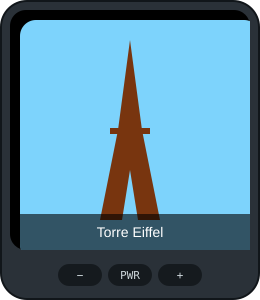

Para coisas recentes ou que ele não sabe, ele pesquisa e cita a fonte.

- *"Pesquisa quem ganhou o jogo do Grêmio ontem"*
- *"Quais as notícias de hoje?"* · *"Notícias de tecnologia"*
- *"Mostra uma foto da Torre Eiffel"*
- *"Mostra a imagem deste link: …"*

Fontes de pesquisa:

- **Sem chave:** pesquisa na Wikipedia e nas notícias do Google Notícias.
- **Com chave do Brave Search** (grátis, opcional): pesquisa na web inteira. Cole a chave na [página de configurações](#página-de-configurações).

<br clear="right">

---

## Clima e cotações

Os dois serviços são grátis e não pedem chave. A tela some sozinha depois de 20 segundos.

### Clima

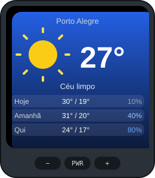

- *"Como está o tempo em Porto Alegre?"*
- *"Vai chover amanhã?"*
- *"Previsão para o fim de semana"*

A cidade que você falar fica salva. Depois basta perguntar *"e o tempo hoje?"*.

**Alerta de chuva:** com uma cidade salva, ele confere a cada 30 minutos, entre 7h e 22h. Se vier tempestade ou chuva forte nas próximas 3 horas, ele avisa.

<br clear="right">

### Cotações

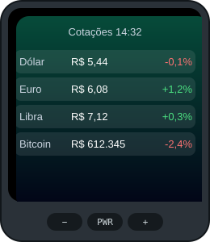

- *"Quanto está o dólar?"*
- *"Cotação do peso argentino e do ethereum"*
- *"Quanto é 100 euros em reais?"*

Sem pedir uma moeda específica, ele mostra dólar, euro, libra e bitcoin. A variação do dia aparece em verde (subiu) ou vermelho (caiu). Os valores da imagem são só exemplos.

<br clear="right">

---

## Tradutor

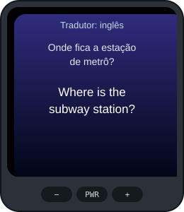

Um intérprete de bolso para conversar com quem fala outra língua.

- *"Modo tradutor para inglês"*
- *"Tradutor de espanhol"*
- *"Para de traduzir"*

Cada frase em português ele fala traduzida. Quando a outra pessoa responde na língua dela, ele traduz de volta para o português. A tela mostra as duas frases.

<br clear="right">

---

## Casa inteligente (Home Assistant)

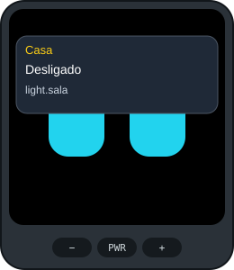

O robô controla lâmpadas, tomadas, interruptores, ventiladores, cortinas, ar-condicionado, fechaduras, cenas e automações cadastrados no **Home Assistant**, de qualquer marca que o Home Assistant aceite.

- *"Apaga a luz da sala"*
- *"Acende a luz do quarto em azul a 30%"*
- *"Deixa a luz da cozinha branco quente"*
- *"Liga o ventilador"* · *"Fecha a cortina"*
- *"Coloca o ar em 23 graus"*
- *"Ativa a cena cinema"*
- *"A luz da varanda está acesa?"*
- *"Quais luzes eu tenho?"*

Os nomes usados são os mesmos do Home Assistant. Dar a cada aparelho um nome e um cômodo (área) claros ajuda o robô a acertar.

<br clear="right">

### Como ligar o robô ao Home Assistant

1. No Home Assistant, clique no seu **nome de usuário** (canto inferior esquerdo) e abra a aba **Segurança**.
2. Em **Tokens de acesso de longa duração**, clique em **Criar token**, dê o nome "Robô" e copie o token. Ele só aparece uma vez.
3. Diga ao robô *"abre as configurações"* e escaneie o QR code com o celular.
4. Preencha o **endereço** do Home Assistant (o mesmo que você abre no navegador, por exemplo `http://192.168.0.10:8123`) e cole o **token**. Toque em Salvar.

> [!NOTE]
> O robô e o Home Assistant precisam estar na mesma rede WiFi, a não ser que o seu Home Assistant tenha um endereço de acesso pela internet.

---

## Página de configurações

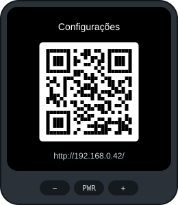

Chaves longas não dá para ditar. Elas são coladas pelo celular.

1. Diga *"abre as configurações"*. A tela mostra um QR code.
2. Com o celular **na mesma rede WiFi**, aponte a câmera para o QR code e abra a página.
3. Cole a chave do **AudD** (reconhecer músicas), do **Brave Search** (pesquisa na web) ou o endereço e o token do **Home Assistant** (casa inteligente) e toque em Salvar.

A página fecha sozinha em 5 minutos, ou na hora com `PWR`. Um campo deixado em branco mantém a chave que já estava salva.

<br clear="right">

---

## Robô e PC

Há duas formas de o robô mexer no seu computador.

### Pela internet: ferramentas no PC (MCP)

O MCP é um jeito de dar ao robô novas habilidades que rodam no seu computador: ler arquivos, fazer contas, consultar um programa seu. Um pequeno programa em Python fica aberto no PC e se conecta ao robô pela internet. Não precisa de cabo.

1. **Instale o Python 3.10 ou mais novo** pelo site python.org. Na instalação, marque *Add Python to PATH*.
2. **Baixe o exemplo oficial** do projeto xiaozhi: em [github.com/78/mcp-calculator](https://github.com/78/mcp-calculator), clique em **Code › Download ZIP** e extraia a pasta.
3. **Instale as dependências:** abra o Prompt dentro da pasta extraída e rode:

   ```bash
   pip install -r requirements.txt
   ```

4. **Pegue o endereço MCP do seu robô:** entre em xiaozhi.me com a conta onde o robô está ativado, abra as configurações do agente e procure a opção **MCP**. Copie o endereço, que começa com `wss://`.
5. **Ligue o programa**, colando o seu endereço no lugar do exemplo. Deixe a janela aberta enquanto quiser usar.

   Windows:

   ```bat
   set MCP_ENDPOINT=wss://cole-aqui-o-seu-endereco
   python mcp_pipe.py calculator.py
   ```

   Mac ou Linux:

   ```bash
   export MCP_ENDPOINT=wss://cole-aqui-o-seu-endereco
   python3 mcp_pipe.py calculator.py
   ```

O exemplo ensina o robô a fazer contas no PC. Experimente: *"quanto é a raiz quadrada de 7 vezes 3?"*

#### Criar suas próprias ferramentas

Cada função marcada com `@mcp.tool()` vira uma habilidade nova. O robô lê a descrição para saber quando usar. O exemplo abaixo deixa o robô listar e ler arquivos de uma pasta. Salve como `meu_pc.py` na mesma pasta e rode `python mcp_pipe.py meu_pc.py`.

```python
from pathlib import Path
from mcp.server.fastmcp import FastMCP

mcp = FastMCP("MeuPC")
PASTA = Path.home() / "Documents"   # o robo so ve esta pasta

@mcp.tool()
def listar_arquivos() -> list[str]:
    """Lista os arquivos da pasta Documentos do usuario."""
    return [p.name for p in PASTA.iterdir()][:100]

@mcp.tool()
def ler_arquivo(nome: str) -> str:
    """Le um arquivo de texto da pasta Documentos pelo nome."""
    caminho = (PASTA / nome).resolve()
    if PASTA.resolve() not in caminho.parents:
        return "Fora da pasta permitida."
    return caminho.read_text(encoding="utf-8")[:4000]

if __name__ == "__main__":
    mcp.run(transport="stdio")
```

Fale: *"Lista meus documentos"* · *"Lê o arquivo notas.txt"*

> [!WARNING]
> Só dê ao robô acesso ao que for seguro. Qualquer pessoa que falar com ele pode usar essas ferramentas. Evite ferramentas que apagam arquivos ou rodam comandos.

### Pelo cabo: modo teclado USB

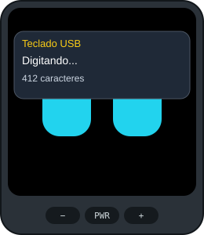

O robô vira um teclado e digita na janela aberta do PC. Acentos e símbolos saem certos em teclado ABNT2 ou americano. Funciona só no Windows.

1. Ligue o robô no PC pelo cabo e diga *"liga o modo teclado"*.
2. Abra o **Bloco de Notas** e clique dentro dele.
3. Peça o que escrever. Ele digita sozinho.

- *"Escreve um programa em Python que mostra a tabuada do 7"*
- *"Aperta ctrl+s"*
- *"Cancela a digitação"*
- *"Desliga o modo teclado"*

> [!WARNING]
> Com o modo ligado, qualquer pessoa que falar com o robô pode digitar e usar atalhos no seu PC. Ligue só quando for usar. Ao desligar o modo, ou ao reiniciar, o USB volta ao normal.

<br clear="right">

---

## Especificações

### Hardware

| Item | Especificação |
|---|---|
| Placa | Waveshare ESP32-S3-LCD-1.54 |
| Processador | ESP32-S3, 2 núcleos Xtensa LX7 a 240 MHz |
| Memória | 512 KB de RAM interna · 8 MB de PSRAM · 16 MB de flash |
| Tela | 1,54" IPS colorida, 240×240 pixels, controlador ST7789 (SPI) · sem toque |
| Áudio | Codec ES8311 (alto-falante) e ES7210 (microfone) · 24 kHz |
| Sensor de movimento | QMI8658, 6 eixos (acelerômetro e giroscópio) |
| Armazenamento | Slot microSD (4 bits), FAT32 · recomendado até 32 GB |
| Botões | 3: `−` (também BOOT), `PWR` e `+` |
| Conexão | USB-C nativo do ESP32-S3: alimentação, gravação de firmware e modo teclado |
| WiFi | 2,4 GHz, 802.11 b/g/n · **não conecta em redes de 5 GHz** |
| Bluetooth | 5 (LE) no chip, desligado no firmware |
| Alimentação | 5 V pelo USB-C, ou bateria de lítio de 3,7 V |
| Bateria | Carrega pelo USB-C · nível medido pela placa · desliga sozinho após 5 min sem uso na bateria (exceto com música, vídeo, timer/alarme ou jogo ativo) |

### Software

| Item | Detalhe |
|---|---|
| Firmware | Baseado no projeto de código aberto [xiaozhi-esp32](https://github.com/78/xiaozhi-esp32) (licença MIT), com rosto, jogos e funções próprias |
| Plataforma | ESP-IDF 6.1 · LVGL 9 |
| Inteligência artificial | Servidor xiaozhi.me (conta gratuita, voz e personalidade configuráveis) |
| Idioma | Português do Brasil (fala, telas e configuração) |
| Palavra de ativação | "Jarvis" (WakeNet9, no próprio robô) · só com o robô no cabo |
| Áudio do cartão | MP3, WAV, FLAC, AAC, M4A, OGG |
| Vídeo do cartão | MJPEG 240×240 a 15 quadros/s + MP3 (convertido no PC com ffmpeg) |
| Serviços de internet | Open-Meteo (clima), AwesomeAPI (cotações), Wikipedia e Google Notícias (pesquisa), Radio Browser (rádios), iTunes (podcasts), Internet Archive (música livre) · opcionais com chave grátis: AudD (reconhecer música) e Brave Search (pesquisa na web) |
| Casa inteligente | Home Assistant (API REST com token de longa duração) |

---

## Problemas comuns

| Problema | O que fazer |
|---|---|
| "Não foi possível conectar ao serviço" | Confira se o WiFi tem internet. Se você trocou de rede, diga "entra no modo de configuração de WiFi" ou refaça a configuração. |
| Ele não conversa depois de ligar pela primeira vez | Falta ativar na conta xiaozhi.me. Veja [Ativar o robô](#ativar-o-robô-na-sua-conta-obrigatório). |
| Ele não me ouve depois de tocar uma rádio | Aperte `PWR` de novo. Se continuar, peça "para a música". |
| Ele não acorda com "Jarvis" | Confira se está no cabo: na bateria a palavra fica desligada. Fale mais perto e com clareza, "djárvis". |
| A tela travou ou não responde | Tire e coloque o cabo USB de novo. Na bateria, segure `PWR` para desligar e aperte de novo para ligar. |
| Ele desligou sozinho | Na bateria, ele desliga após 5 minutos sem conversa e sem música, vídeo, alarme ou jogo. Aperte `PWR` para ligar ou use o carregador. |
| O PC parou de mostrar a porta do robô | O modo teclado pode estar ligado. Diga "desliga o modo teclado" ou reinicie o robô. |
| Música ou vídeo não aparecem | O cartão precisa estar em FAT32. As músicas podem ficar em qualquer pasta. Os vídeos ficam na pasta `videos`, sempre com o par `.mjpeg` e `.mp3`. |
| "Memória cheia" | Coloque um cartão SD ou peça para ele esquecer lembranças antigas. |

---

## Licença

O firmware deste produto é baseado no projeto de código aberto [xiaozhi-esp32](https://github.com/78/xiaozhi-esp32), distribuído sob a licença MIT. O aviso de licença está em [LICENSE-xiaozhi-esp32.txt](LICENSE-xiaozhi-esp32.txt).

Este manual, os textos e as ilustrações: todos os direitos reservados.

